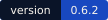
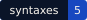
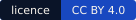
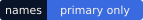
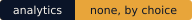

<p align="center"><a href="https://syntax.prayasabhinav.net"></a></p>

<p align="center">
<a href="CHANGELOG.md"></a>
<a href="#syntaxes"></a>
<a href="LICENSE"></a>
<a href="https://syntax.prayasabhinav.net"></a>
<br>
<a href="#the-rules-every-syntax-keeps"></a>
<a href="#the-rules-every-syntax-keeps"></a>
<a href="#the-rules-every-syntax-keeps"></a>
<a href="#building-and-deploying"></a>
<a href="#no-counting"></a>
</p>

<p align="center">
<a href="https://syntax.prayasabhinav.net/board-game/"></a>&nbsp;
<a href="https://syntax.prayasabhinav.net/record/"></a>&nbsp;
<a href="https://syntax.prayasabhinav.net/personhood/"></a>&nbsp;
<a href="https://syntax.prayasabhinav.net/framework/"></a>&nbsp;
<a href="https://syntax.prayasabhinav.net/life/"></a>
</p>

A kind of thing can be broken into the same parts every time. SYNTAX writes those parts down: the element types a kind of thing has, and the elements of each type. Once they are written, each thing of that kind can be described as a choice of elements, compared with others, and made by choosing differently.

A board game, for example, always has a core mechanic, a victory condition, a way of timing turns. Each of those is an element type, and *worker placement* or *race to finish* is an element. A particular game is one choice from each type. boardgameBuilder is a tool built on that syntax; SYNTAX is where the syntax itself is kept, alongside syntaxes for other kinds of things.

The site is at **https://syntax.prayasabhinav.net**. This repository holds the program that builds it, the built site, and every syntax as a JSON file.

## Contents

- [The words](#the-words)
- [Syntaxes](#syntaxes)
- [The rules every syntax keeps](#the-rules-every-syntax-keeps)
- [The syntax file](#the-syntax-file)
- [The family mark](#the-family-mark)
- [The site and its data](#the-site-and-its-data)
- [Adding a syntax](#adding-a-syntax)
- [Building and deploying](#building-and-deploying)
- [Versions](#versions)
- [Files](#files)
- [No counting](#no-counting)
- [Licence and credits](#licence-and-credits)

## The words

| Word | What it means here |
|---|---|
| **syntax** | how one kind of thing breaks into element types and elements, named by the primary name of the kind of thing it breaks up, never by a tool or a brand |
| **element type** | one group of parts every thing of that kind has; it holds one element or several |
| **element** | one part |
| **entity** | one particular thing of that kind, described as its choice of elements |
| **instance** | a tool or a project built on a syntax |
| **left out** | what a syntax does not describe, or who cannot hold a part of it, said in words |
| **thing** | a holder that is not a person, such as a model or code; it holds a part only as a tool a person set up, and has no personhood |

## Syntaxes

The table below is written by `build.py` from the same list the site is built from, so it cannot fall behind the site.

<!-- syntaxes:start -->
| Mark | Syntax | Element types | Elements | Read from | Instances | As data |
|---|---|---|---|---|---|---|
|  | [**board game**](https://syntax.prayasabhinav.net/board-game/) | 8 | 86 | boardgameBuilder | boardgameBuilder | [`board-game.json`](https://syntax.prayasabhinav.net/board-game.json) |
|  | [**record**](https://syntax.prayasabhinav.net/record/) | 3 | 6 | Zariia | Zariia | [`record.json`](https://syntax.prayasabhinav.net/record.json) |
|  | [**personhood**](https://syntax.prayasabhinav.net/personhood/) | 4 | 17 | Split-Domain Cognition | Split-Domain Cognition; Koher | [`personhood.json`](https://syntax.prayasabhinav.net/personhood.json) |
|  | [**framework**](https://syntax.prayasabhinav.net/framework/) | 5 | 13 | the Museum of Vestigial Desire | Museum of Vestigial Desire | [`framework.json`](https://syntax.prayasabhinav.net/framework.json) |
|  | [**life**](https://syntax.prayasabhinav.net/life/) | 5 | 10 | Split-Domain Cognition | Split-Domain Cognition's animal-rights variant | [`life.json`](https://syntax.prayasabhinav.net/life.json) |
<!-- syntaxes:end -->

Each syntax is read from the project that holds it. Where a syntax lives in one project and SYNTAX copies it, the two drift; here the build reads the instance's own file every time, so the site and the instance cannot say different things.

## The rules every syntax keeps

**A syntax is named by its primary name.** The name is the plain word for the kind of thing it breaks up, in lower case: *board game*, *record*, *life*. Never a tool, a brand or a project. The build checks every name against `^[a-z]+( [a-z]+)*$` and stops on one that fails.

**Every syntax says what it leaves out.** A list of element types silently excludes everything not on it, and a silent exclusion cannot be argued with. So each syntax carries a `left_out` sentence, shown on its page under *Left out*, and the build stops on a syntax without one. The personhood syntax, for example, says that a model and code are excluded because they are things, and that an animal is partially excluded: it holds intent and nothing else there.

**AI is a thing.** Where a syntax lets something other than a person hold a part, as the personhood syntax does for *a model under negotiation* and *code*, the element is marked `"thing": true` and its page labels it THING. A thing holds a part only as a tool a person set up for that work.

**One source per syntax.** The syntax is written once, in the instance that holds it, and SYNTAX reads it from there. Nothing is copied into this repository by hand; the `site/<slug>.json` files are build output.

**Each syntax has a mark drawn by one rule**, described below, so a new syntax gets a mark without anybody designing one.

## The syntax file

A syntax is a JSON object. The board game syntax is assembled from boardgameBuilder's Python files; every other syntax is a JSON file in its instance's tree, in this shape:

```json
{
 "name": "record",
 "breaks_up": "a record with two channels in one file: one that plays for anyone, and one sealed with a key",
 "element_types": [
  {
   "name": "class",
   "holds": "one",
   "description": "What the sealed channel is, beside the open one.",
   "elements": [
    {"name": "the counter-voice", "description": "another take of the same moment"},
    {"name": "the reply", "description": "a second musician answering, recorded later"}
   ]
  }
 ],
 "left_out": "What either channel says or sounds like: the syntax names what each channel is, never its content."
}
```

| Field | Required | What it holds |
|---|---|---|
| `name` | yes | the primary name, lower case, letters and single spaces only |
| `breaks_up` | yes | what the syntax breaks up, as a phrase that follows *It breaks up …* on the page |
| `element_types` | yes | a list, in the order they are shown |
| `element_types[].name` | yes | the element type's name |
| `element_types[].holds` | yes | `"one"` or `"several"`: how many of its elements one entity can choose |
| `element_types[].description` | yes | one or two sentences on what the type is |
| `element_types[].elements` | yes | a list; it may be empty where the type is a slot rather than a choice, as the record's open and sealed channels are |
| `elements[].name` | yes | the element's name |
| `elements[].description` | yes | what the element is |
| `elements[].thing` | no | `true` when the holder is not a person |
| `elements[].letter` | no | a short code an instance uses for the element (the record syntax's class letters, written into each record) |
| `left_out` | yes | what the syntax does not describe, or who cannot hold a part of it |
| `note` | no | a paragraph shown under the opening line of the syntax's page |

The published file at `/<slug>.json` adds what `build.py` knows about the syntax: `read_from`, `slug`, `instances` (each with `name`, `url`, `what` and `links`) and `described_entities`.

## The family mark

Every syntax's mark is drawn by `family_mark()` in `build.py` from the syntax itself. There is one row for each element type and three cells in each row. One cell in each row is lit, at a place set by the first byte of the SHA-256 of `<syntax name>/<element type name>`, taken modulo three. Lit cells are cobalt, except the last row's, which is the one warm colour. SYNTAX's own mark is the same rule drawn by hand for three rows.

So the mark changes only when the syntax does: add an element type and the mark grows a row; rename one and its lit cell may move. A syntax's mark is at `site/<slug>/mark.svg` here and at `/<slug>/mark.svg` on the site.

| Colour | Hex | Used for |
|---|---|---|
| ground | `#0a1428` | the field behind the mark |
| deep | `#12213f` | an unlit cell |
| cobalt | `#1848c0` | a lit cell |
| warm | `#e8a53a` | the last row's lit cell |

## The site and its data

| Address | What it serves |
|---|---|
| `/` | what SYNTAX is, the words, and every syntax |
| `/syntaxes/` | the list of syntaxes |
| `/<slug>/` | one syntax: its instances, element types and elements, what it leaves out, what is described in it |
| `/<slug>.json` | the same syntax as data, in the shape above |
| `/<slug>/mark.svg` | its family mark |
| `/og/<slug>.png` | its link-preview image, 1200 × 630 |
| `/favicon.svg` | SYNTAX's own mark |

The slug is the name with spaces turned into hyphens: `board-game`, `record`, `personhood`, `framework`, `life`. The JSON files are plain static files with no key and no limit; anybody may build on them under the licence.

## Adding a syntax

1. Write the syntax as `<name>-syntax.json` in the tree of the project that holds it, in the shape above, with a `left_out` sentence.
2. Add an entry to `SYNTAXES` in `build.py` that reads the file and names its instances, following the entries already there.
3. Run `python3 og.py` to draw its link-preview image. The build refuses a syntax that has none, so a new syntax cannot go out with another's picture.
4. Raise the middle number in `VERSION` and add an entry at the top of `CHANGELOG.md` with the same number.
5. Build and deploy, below.

## Building and deploying

`build.py` needs Python 3 and nothing else. It reads the syntaxes from the projects beside this one (`../boardgame-builder`, `../zariia`, `../splitdomaincognition`, `../museumofvestigialdesire.net`), so it runs only where those sit next to it. A clone of this repository on its own cannot rebuild the site, which is why the built `site/` is committed: everything the site serves is here.

```bash
python3 build.py      # writes site/, the badges and the syntaxes table in this README
python3 og.py         # draws og/*.png with headless Chrome; set CHROME to the browser's path if it is not found
./make-tar.sh         # runs build.py, then packs syntax.tar
caprover deploy -n myplaceholder -a syntax -t syntax.tar
```

The build stops, with a message saying why, if a syntax is not named by a primary name, if a syntax does not say what it leaves out, if `VERSION` and the newest entry in `CHANGELOG.md` disagree, or if a syntax has no preview image.

The site is static files served by nginx in a container (`Dockerfile`, `nginx.conf`, `captain-definition`). nginx keeps no access log.

## Versions

The version is in `VERSION` and printed on every page and in the version badge above. The middle number rises for something people can use, such as a new syntax; the last for a fix. `CHANGELOG.md` records what changed, newest first. `ROADMAP.md` lists what could come next.

## Files

| File | What it is |
|---|---|
| `build.py` | reads the syntaxes, checks them, writes `site/`, `badges/` and this README's syntaxes table |
| `og.py` | draws the link-preview images into `og/` |
| `style.css` | the site's look, inlined into every page |
| `brand/` | SYNTAX's mark and lockup |
| `badges/` | the badges at the top of this README, drawn by `build.py` |
| `fonts/` | Mukta, self-hosted, with its licence |
| `og/` | the link-preview images |
| `site/` | the built site; never edited by hand |
| `Dockerfile`, `nginx.conf`, `captain-definition`, `make-tar.sh` | the deploy |
| `VERSION`, `CHANGELOG.md`, `ROADMAP.md` | the version, what changed, what could come next |
| `LICENSE` | CC BY 4.0 |

## No counting

The site has no analytics, no counters and no access log, and this README has no badge that counts stars, downloads or visitors. How many people read it is not known, by choice.

## Licence and credits

SYNTAX is by [Prayas Abhinav](https://prayasabhinav.net), licensed [CC BY 4.0](https://creativecommons.org/licenses/by/4.0/) (`LICENSE`): copy it, change it and build on it, including commercially, and say where it came from.

The site is set in [Mukta](https://github.com/EkType/Mukta) by Ek Type, under the SIL Open Font License (`fonts/OFL.txt`).
